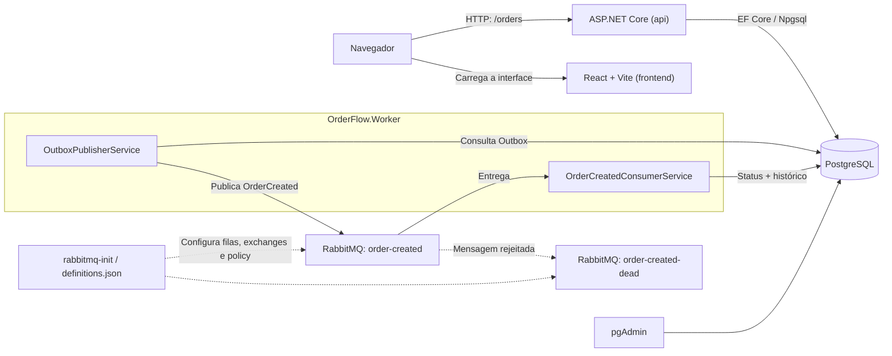
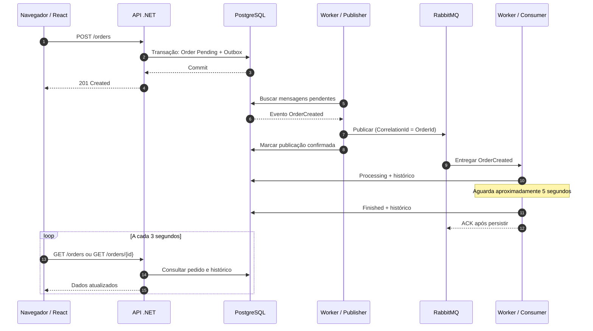
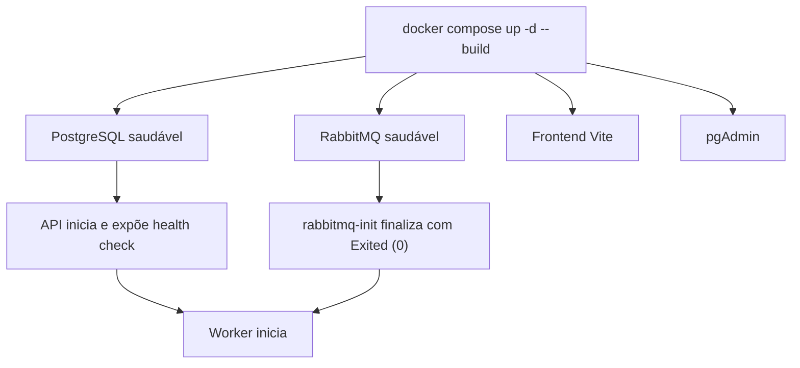

# Arquitetura do OrderFlow

A aplicação é executada em um ambiente local com Docker Compose: `frontend`, `api`, `worker`, `postgres`, `pgadmin`, `rabbitmq` e `rabbitmq-init`.

## Visão geral

> O frontend é servido por um container, mas o `fetch()` é executado pelo navegador. Por isso, a URL da API no React é `http://localhost:8080`. Já entre containers, PostgreSQL e RabbitMQ são endereçados por `postgres` e `rabbitmq`.

## Criação e processamento

## Orquestração e inicialização

**Migrations:** a aplicação automática depende da chamada efetiva a `Database.MigrateAsync()` na inicialização da API. Sua execução em um banco vazio deve ser validada em ambiente isolado antes de registrar o requisito como concluído.

## Decisões técnicas

- **Domínio rico:** `Order` controla mudanças de status e seu histórico.
- **Outbox transacional:** pedido e intenção de publicar o evento são persistidos juntos.
- **Mensageria assíncrona:** RabbitMQ desacopla o recebimento HTTP do processamento.
- **ACK manual e reentrega:** o processamento é confirmado depois da persistência.
- **DLQ:** mensagens rejeitadas podem ser inspecionadas sem bloquear a fila principal.
- **Concorrência otimista:** o mapeamento `xmin` evita sobrescrever silenciosamente determinadas alterações concorrentes.
- **Polling:** o React atualiza a interface a cada três segundos, sem alegar comunicação push em tempo real.
